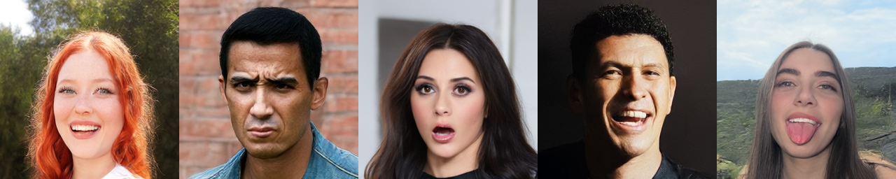

# Visage-Image

**[Model card and weights](https://huggingface.co/Sherstnev/Visage-Image)** · **[Architecture](ARCHITECTURE.md)** · **[Prompting](PROMPTING.md)** · **[Data](DATA.md)**



## Introduction

A 256px text-to-image model for face generation: a 237M-parameter single-stream diffusion transformer
over the latents of a 128M-parameter f16 autoencoder (16×16×96 latents), conditioned on
layer 8 of Qwen3-0.6B.

This model started as an experiment in training a DiT on data from a limited domain. With so many models available for face detection and for tasks like age and gaze estimation, preparing a custom dataset was fairly simple, time-consuming, but simple. I first tried the FLUX.2 VAE, but it turned out that the plastic look is an inherent vice of that model, it turns anything it touches into plastic. It is optimized for learnability, its latent channels have a lot of redundancy, and it fakes details with GAN-style generation, which makes them look plausible rather than faithful. So I trained my own autoencoder using the latest ideas and recipes, and it turned out quite well. Qwen3-0.6B makes the model robust to variations in prompt wording, and unlike most small general-purpose DiTs, it generates quite good faces. In fact, to train a very specific DiT you don't need a big dataset: a set of similar images that differ only in details is enough, because a DiT interpolates between them very well. The first version of this model was like that. I found a "good region" densely populated with similar images. Samples from it were very realistic, and outside it they were a mess.

The [model card](https://huggingface.co/Sherstnev/Visage-Image) has the highlights, samples and evaluation. [ARCHITECTURE.md](ARCHITECTURE.md) covers each design choice and what was tried instead.

## Repository layout

| path | what |
|---|---|
| `visage/dit.py` | DiT: 18 single-stream blocks, width 768, adaLN timestep conditioning, Qwen3-0.6B captions with learned bucket pads and 16 registers, spiral 2D RoPE |
| `visage/vae.py` | VAE: Haar-wavelet conv encoder with self-attention at f8 and f16 → 96ch f16 latent; two-stage ViT decoder (f16 → f8) + 8×8 patch head + two residual conv refiners |
| `visage/sampling.py` | Qwen3 text encoder (first 8 layers), rectified-flow sampler (Euler / SDE churn, CFG) |
| `visage/loading.py` | `load_dit` / `load_vae` / `load_text_encoder` from a model directory or hub repo id |
| `visage/training.py` | manifest dataset, config loading, Muon + AdamW, LR schedule |
| `visage/adversarial.py` | latent critic for adversarial post-training: trainable heads on a frozen copy of the DiT |
| `scripts/generate.py` | text-to-image CLI |
| `scripts/make_showcase.py` | rebuilds `assets/showcase.png`; holds each tile's prompt and seed |
| `PROMPTING.md` | long-caption format, vocabulary and example prompts |
| `DATA.md` | how the images were curated and captioned, and which model labels each slot |
| `scripts/crop_faces.py` | square head crops from a photo folder, plus a `train.jsonl` manifest |
| `scripts/train_dit.py`, `scripts/train_vae.py` | training loops; configs in `configs/` (`dit_adversarial.yaml` is the release's last stage) |

## Quick Start

```bash
pip install -e .            # add [train] for training: pip install -e ".[train]"
python scripts/generate.py "a young woman with long red hair and freckles, soft window light" --n 4
```

The weights download from the [Hugging Face repo](https://huggingface.co/Sherstnev/Visage-Image) on first use. `--model` also takes a local copy:
`huggingface-cli download Sherstnev/Visage-Image --local-dir weights`, then `--model weights`. The loaders read one folder per
component: `transformer/` and `vae/` hold `config.json` + `model.safetensors`, and `text_encoder/config.json` names
the frozen Qwen3 encoder.

Recommended sampler settings, which are the defaults: `--solver sde --churn 0.3 --cfg 3 --steps 50 --shift 3.3`.
- **Euler**: crisper but less realistic.
- **churn**: applied every step, so raising `--steps` without lowering churn washes the image out.
- **shift**: depends on the token count. Retune it if you change resolution.
- **cfg**: depends on the caption-dropout rate.

Detailed structured captions follow best, but
short and casual prompts were trained from step 0 and work. Bare prompts default to sharp; no sharpness word is needed.
[PROMPTING.md](PROMPTING.md) lists the long-caption slots in order, with common values and examples.
256px only: the VAE loses 3.2 dB on eye crops at 512.

The strip at the top is `python scripts/make_showcase.py`: default sampler settings, with the
prompts and seeds listed in the script, one image per seed. Any tile is also
`python scripts/generate.py "<prompt>" --n 1 --seed <seed>`.

## Train

The data is a JSONL manifest with one `{"image": "path.jpg", "caption": "..."}` per line.
Relative paths are resolved against the manifest's directory. The VAE ignores captions.
`scripts/crop_faces.py` builds one from a folder of photos with the same detector and head
margins as the release data (YOLO face weights, AGPL-3.0; the download line is in the script's
`--help`). Captions come out empty and have to be filled in before DiT training.

```bash
pip install -e ".[data]"
python scripts/crop_faces.py photos/ -o data/          # -> data/images/..., data/train.jsonl
python scripts/train_vae.py configs/vae.yaml   # -> runs/vae/vae/ (+ latent stats)
python scripts/train_dit.py configs/dit.yaml   # uses the VAE in `vae:` -> runs/dit/transformer/ (EMA)
```

**VAE**
- Loss: Charbonnier + 3·LPIPS(VGG) + 0.4·DINOv2 alignment. The alignment is mcos + mdms on a middle-layer feature, with margins that loosen over 200k steps to 0.2 of their full slack, then hold.
- From step 80k, a phase-template term removes the decoder's fixed 8px sub-pixel pattern.
- No KL and no GAN. Horizontal flips. 400k steps at batch 8.
- Optimizer: Muon on the decoder's hidden matrices, AdamW for the rest. Cosine LR schedule.

**DiT**
- Rectified flow with velocity target and logit-normal timesteps, shifted by √(tokens/64).
- 20% caption dropout to a zero embedding. The release drew dropout from sharp images only and
  omitted the sharpness word on sharp captions, so an unspecified prompt defaults to sharp; this
  loop drops uniformly.
- Muon + AdamW, EMA 0.999 every 10 steps, batch 64×2.
- The release then ran `configs/dit_adversarial.yaml`: 1000 updates of latent adversarial post-training on the
  anneal checkpoint (see [ARCHITECTURE.md](ARCHITECTURE.md#training)).

Checkpoint names (200k, 220k, 222k) count batches of 64, as the training repo did. `scripts/train_dit.py`
counts optimizer updates of 64×2, so 222k there is step 111,000.

The DiT loop encodes images and captions on the fly, which keeps the code minimal. For a
long run, cache the latents and text states once instead.

**Compute.** The release was trained on one NVIDIA RTX 5090 (32 GB):

| model | steps | throughput | wall-clock |
|---|---|---|---|
| VAE | 400k at batch 8 | ~10.7 it/s | ~10.5 h |
| DiT, base run | 200k batches of 64 | ~5.1 batches/s (~330 images/s) | ~11 h |
| DiT, sharp anneal | 20k batches of 64 | ~5.1 batches/s | ~1.1 h |
| DiT, adversarial | 2k batches of 64 | ~2 batches/s | ~0.3 h |
| **total** | | | **~23 GPU-hours** |

The DiT figures are with latents and text states cached in advance.

Lint and format with `ruff check . && ruff format .` (config in `pyproject.toml`).

## License

The code and the weights are [Apache-2.0](LICENSE).

## References

**DiT**
- Rectified flow: Liu et al., *Flow Straight and Fast* — [arXiv:2209.03003](https://arxiv.org/abs/2209.03003); Lipman et al., *Flow Matching* — [arXiv:2210.02747](https://arxiv.org/abs/2210.02747)
- Logit-normal timesteps, resolution-dependent shift: Esser et al., *Scaling Rectified Flow Transformers* (SD3) — [arXiv:2403.03206](https://arxiv.org/abs/2403.03206)
- DiT, adaLN-Zero: Peebles & Xie — [arXiv:2212.09748](https://arxiv.org/abs/2212.09748)
- Text and image tokens in one sequence: Bao et al., *All are Worth Words* (U-ViT) — [arXiv:2209.12152](https://arxiv.org/abs/2209.12152); joint text–image attention: SD3 (above); single-stream blocks at scale: FLUX.1 — [github.com/black-forest-labs/flux](https://github.com/black-forest-labs/flux)
- Spiral RoPE: Liu et al., *Rotate Your Rotary Positional Embeddings in the 2D Plane* — [arXiv:2602.03227](https://arxiv.org/abs/2602.03227)
- RoPE: Su et al., *RoFormer* — [arXiv:2104.09864](https://arxiv.org/abs/2104.09864)
- Register tokens: Darcet et al., *Vision Transformers Need Registers* — [arXiv:2309.16588](https://arxiv.org/abs/2309.16588)
- QK-norm: Dehghani et al., *Scaling Vision Transformers to 22B* — [arXiv:2302.05442](https://arxiv.org/abs/2302.05442)
- SwiGLU: Shazeer, *GLU Variants Improve Transformer* — [arXiv:2002.05202](https://arxiv.org/abs/2002.05202)
- Text encoder: Qwen3 Technical Report — [arXiv:2505.09388](https://arxiv.org/abs/2505.09388)
- Classifier-free guidance: Ho & Salimans — [arXiv:2207.12598](https://arxiv.org/abs/2207.12598)
- SDE churn sampler: Karras et al., *EDM* — [arXiv:2206.00364](https://arxiv.org/abs/2206.00364)

**VAE**
- Losses (no KL/GAN, DINOv2 mcos + mdms alignment), global skip: *Qwen-Image-VAE-2.0* — [arXiv:2605.13565](https://arxiv.org/abs/2605.13565)
- Wavelet encoder: Sadat et al., *LiteVAE* — [arXiv:2405.14477](https://arxiv.org/abs/2405.14477)
- Space-to-channel residual downsampling: Chen et al., *DC-AE* — [arXiv:2410.10733](https://arxiv.org/abs/2410.10733)
- Alignment target: Oquab et al., *DINOv2* — [arXiv:2304.07193](https://arxiv.org/abs/2304.07193)
- Perceptual loss: Zhang et al., *LPIPS* — [arXiv:1801.03924](https://arxiv.org/abs/1801.03924)
- LayerScale: Touvron et al., *CaiT* — [arXiv:2103.17239](https://arxiv.org/abs/2103.17239)
- iFID: [arXiv:2603.05630](https://arxiv.org/abs/2603.05630)

**Optimizer**
- Muon: Jordan et al. — [kellerjordan.github.io/posts/muon](https://kellerjordan.github.io/posts/muon/); RMS-matched LR: Liu et al., *Muon is Scalable* — [arXiv:2502.16982](https://arxiv.org/abs/2502.16982)
